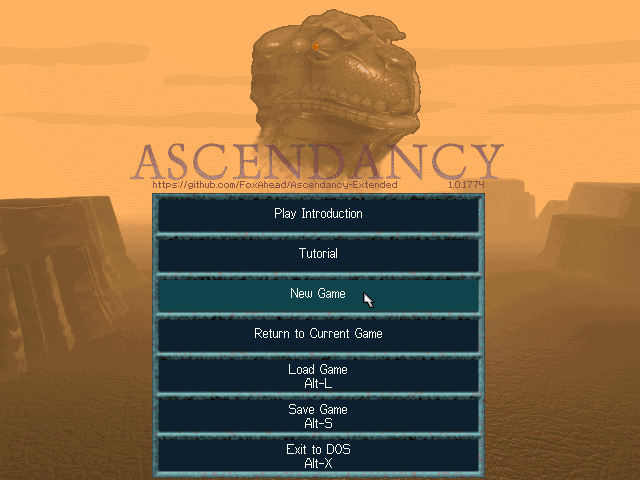
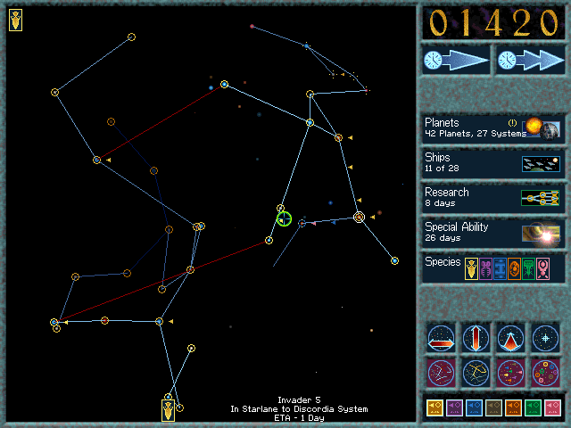
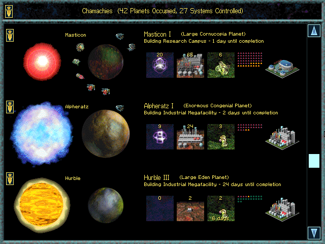
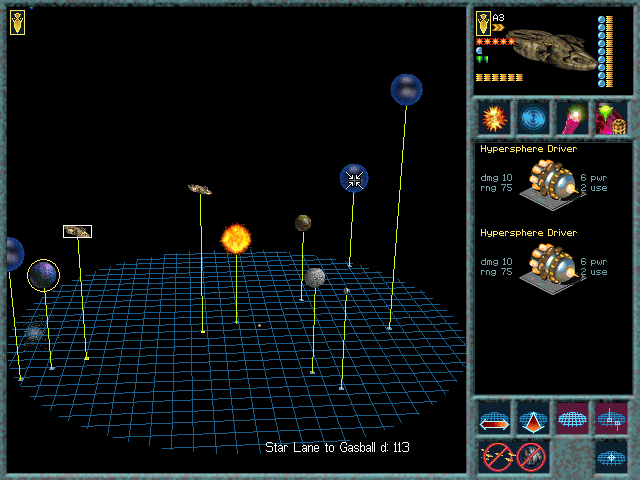
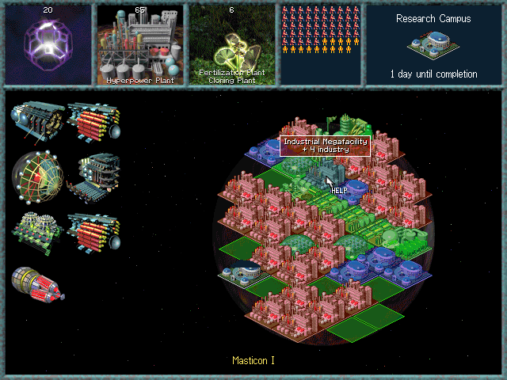
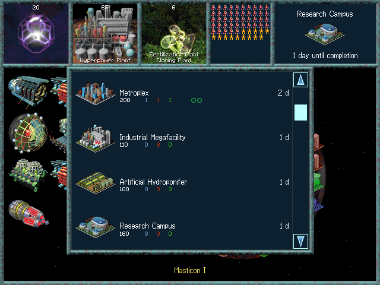
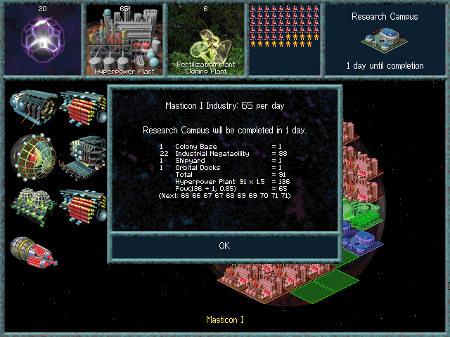
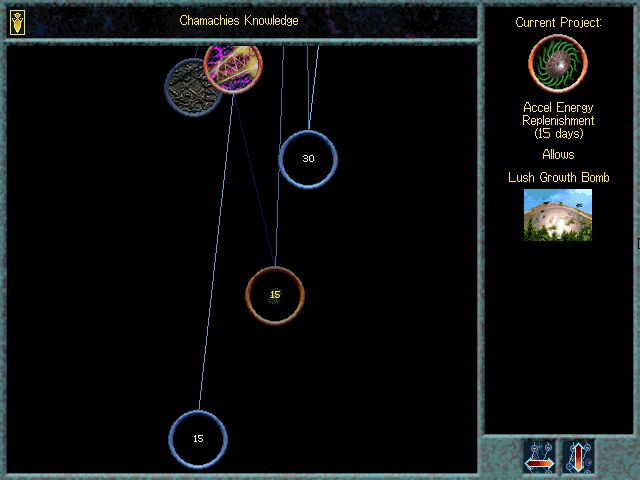
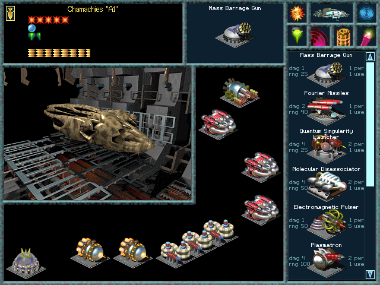

# Ascendancy Extended
An unofficial patch for the game Ascendancy (DOS, 1995) by The Logic Factory.

> **Note:** Currently, this project does not alter the original game rules, balance, or mechanics in any way. It strictly focuses on Quality-of-Life (QoL) improvements and UI enhancements to make the gameplay smoother and more convenient.

## Game Version

This patch is compatible only with game version 1.6.10 (original executable `ANTAG.EXE`).

There are three known versions of the game in total:
- `ASCEND.EXE` v1.6
- `PATCH.EXE` v1.6.5 (Ascendancy bug patch)
- `ANTAG.EXE` v1.6.10 (THE ANTAGONIZER AI Module for Ascendancy)

> This project is based on the latest known version (Antagonizer).

## Installation

Requires the original game with all assets.

Place `ANTAGX.EXE` into your game directory and run it instead of `ANTAG.EXE` (in DOSBox or on a real MS-DOS machine). Save files are fully compatible with the original game.

> Using **DOSBox-X** is recommended. It enables mouse wheel scrolling in lists by setting the option `Mouse wheel movements` to `Convert to PgUp/PgDn keys` (`mouse_wheel_key: 3` under the `[sdl]` section in your `.conf` file).

## Features

### Global & UI
- **List scrollbars**: Renders a scrollbar thumb with mouse drag-and-drop support.
- **Keyboard scrolling** for all lists and the technology tree: `PgUp/PgDn`, `Home/End`.
- **F1 — Hotkey Help**: Opens a modal help window displaying hotkeys relevant to the current screen.

### Main Galaxy Screen

- **F2–F6** duplicate the `Planets / Ships / Research / Special Ability / Species` buttons on the main screen.
- **Enter** advances to the next day (triggers the `NEXTTURN` button).
- Buttons on the right-hand panel display live status info: colony and ship counts, days remaining until research completion, special ability readiness, and `!` warning indicators (idle planets with no build project / no active research project).
- Right-clicking a star only shifts focus (moves the white selection ring) without entering the star system (matching the Diplomacy screen behavior).
- Hovering the mouse cursor over a ship now displays its name and current status.
- Right-clicking a ship immediately opens the Ship screen (ship interior/loadout).

### Planets List

- Displays all orbital structures around a planet (rather than just the Shipyard and Docks).
- Shows the amount of resources generated by the planet (Research, Industry, Prosperity). For Prosperity, it also displays the number of days until the next population growth.
- Displays the icon/image of the planet's current construction project.

### Ships List
- Displays the remaining time until completion for ships that are **Under Construction** or **Being Refitted**.

### Star System Screen

- When an object is selected, hovering over another object also displays the distance between them.
- The installed gizmo list for the selected ship displays item stats: range, power, etc.
- The same stats are also displayed for planetary orbital weapons.

### Planet Screen

- Displays the planet's name and its self-managed status (`M` button).
- Color-coded highlighting for structures matching the color of the tile they are built on, plus an automation marker. Toggleable with the `C` key.
- Hover tooltip for structures (Name, tile color, automation status). Holding **Shift** while hovering shows additional details about the resources generated.
- Clicking an empty tile immediately opens the build list, bypassing the intermediate window with the `Build` button.
- The build list displays extended structure info: cost, resource output, and build time (as well as weapon stats for orbital weapons).
  
- The top Research / Industry / Prosperity info panels display the current output points for each resource. The Prosperity panel also shows the days remaining until population growth.
- Clicking these info panels opens a detailed calculation breakdown (structure contributions, x1.5 special structure bonuses, special projects, power normalization, and population upkeep).  
  

### Research Screen

- Available technology nodes display the number of days required to complete research.
- `PgUp/PgDn` scrolls the tech tree by page, while `Home/End` jumps to the top or bottom.

### Ship Screen

- Extended gizmo stats: range, power, tier/level, etc.
