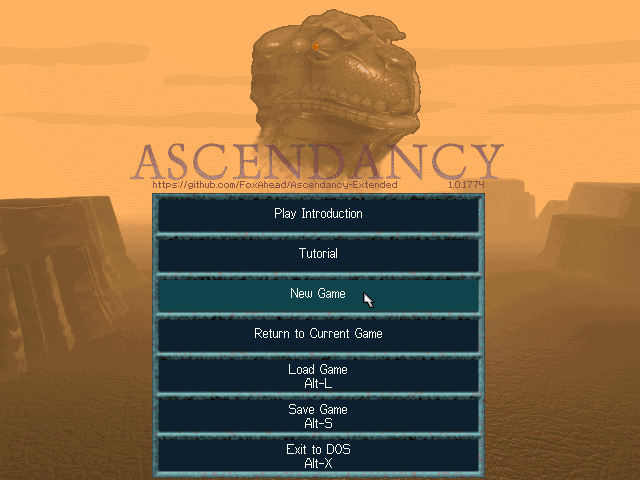
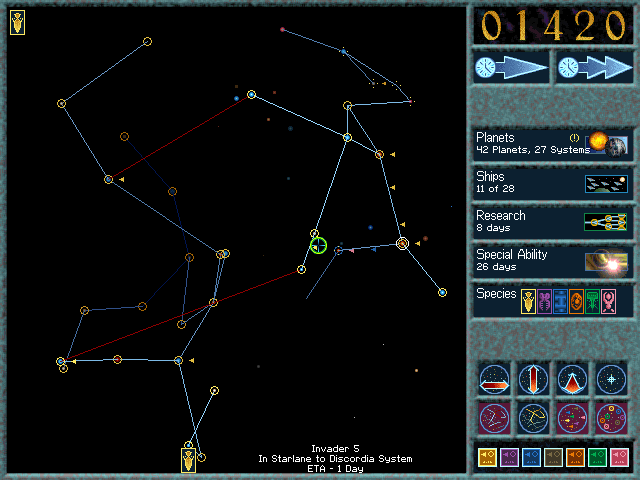
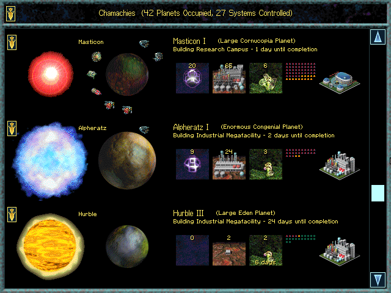
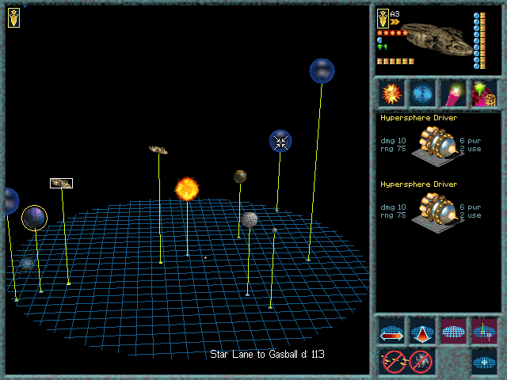
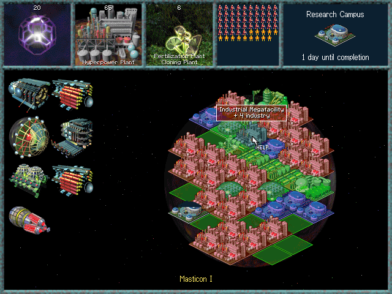
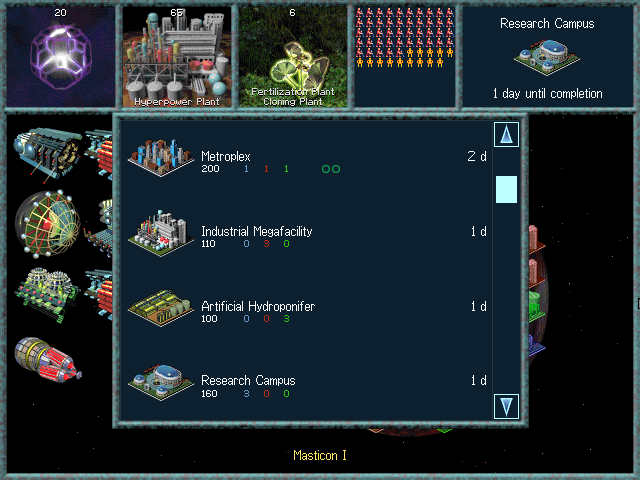
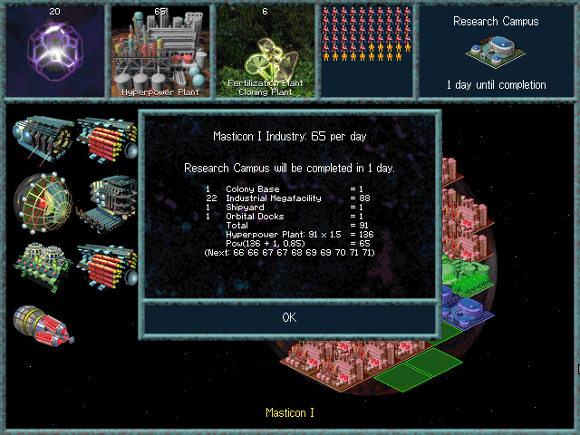
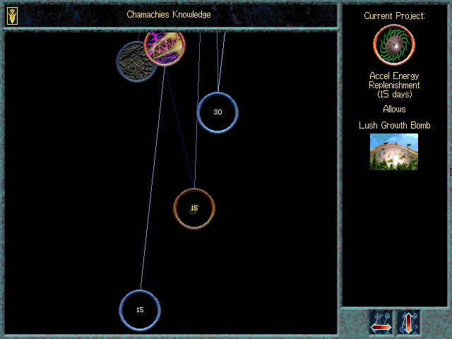
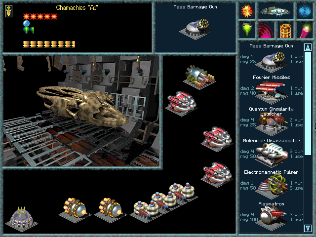

[en](README.md)

# Ascendancy Extended
Неофициальный патч игры Ascendancy (DOS, 1995) от Logic Factory.

> **Примечание:** На данный момент проект никак не изменяет оригинальные правила, баланс или механики игры. Он полностью сосредоточен на Quality-of-Life (QoL) улучшениях и доработке интерфейса для более комфортной игры.

## Версия игры.

Патч только для версии игры 1.6.10 (оригинальный исполняемый файл ANTAG.EXE).

Всего известны три версии игры:
- ASCEND.EXE v   - 1.6
- PATCH.EXE v    - 1.6.5 (Ascendancy bug patch )
- ANTAG.EXE v    - 1.6.10 (THE ANTAGONIZER AI Module for Ascendancy )

> Для данного проекта взята последняя известная версия (Antagonizer).

## Установка

Требуется оригинальная игра со всеми ассетами.

Поместите `ANTAGX.EXE` в каталог игры и запустите его вместо `ANTAG.EXE`
(в DOSBox или реальном MS-DOS). Сейвы совместимы с оригиналом.

> Рекомендуется использовать DOSBox-X. Это позволит задействовать колесо прокрутки мышки в спиках. Для этого надо задать опцию
> `Mouse wheel movements` - `Convert to PgUp/PgDn keys` (`mouse_wheel_key: 3` в секции [sdl] файла .conf)

## Возможности

### Глобальные и интерфейсные
- **Скроллбары списков**: отрисовка ползунка (thumb), перетаскивание ползунка мышью.
- **Клавиатурная прокрутка** всех списков и дерева технологий: `PgUp/PgDn`, `Home/End`.
- **F1 — справка по хоткеям**: модальное окно помощи с перечнем клавиш,
  актуальным для текущего экрана.

### Главный экран галактики

- **F2–F6** на главном экране дублируют кнопки `Planets / Ships / Research /
  Special Ability / Species`.
- **Enter** на главном экране — переход к следующему дню (кнопка NEXTTURN).
- Кнопки правой панели главного экрана показывают живую информацию:
  число колоний и кораблей, дни до завершения исследования, готовность спецспособности,
  индикаторы «!» (планеты без проекта / не выбран проект исследования).
- Правый клик по звезде — только смена фокуса (белое кольцо), без входа в систему
  (поведение экрана дипломатии).
- Теперь наведение курсора мыши работает и на кораблях - выводит его имя и состояние.
- А правый клик по кораблю — сразу открывает экран корабля (содержимое корабля).

### Список планет

- Вокруг планеты отображаются все ее орбитальные постройки (а не только Shipyard и Docks).
- Выводится количество генерируемых планетой ресурсов (Research, Industry, Prosperity). Для Prosperity также количество дней до прироста населения.
- Дополнительно выводится картинка текущего проекта.

### Список кораблей
- Для кораблей Under Construction и Being Refitted выводится оставшееся время до завершения.

### Экран звездной системы

- При выделенном объекте наведение на другой объект также выводит расстояние между ними.
- В списке установленных гизмо для выделенного корабля выводятся характеристики: дальность, мощность и т.д.
- То же самое и для орбитального оружия планеты.

### Экран планеты

- Отображается имя планеты и признак self-managed (кнопка `M`).
- Цветная подкраска построек по цвету клетки, на которой они построены + маркер автоматизации. Переключается клавишей `C`.
- Ховер-подсказка по постройке (Название, цвет, автоматизация). А с нажатым **Shift** — дополнительная информация о получаемых ресурсах.
- Клик по свободной клетке сразу открывает список построек без промежуточного окна с кнопкой Build.
- В списке строительства выводится расширенная информация о постройке: стоимость, ресурсы, время постройки. А для орбитального оружия - его характеристики.  
  
- На верхних инфо-панелях Research/Industry/Prosperity выводятся очки соответствующих ресурсов. А на Prosperity также отображаются дни до прироста населения.
- Клик по этим инфо-панелям выводит детализацию расчёта (вклад построек, бонусы x1.5 спецпостроек, спецпроектов, степенная нормализация, поддержка населения).  
  
- Построенные проекты с одноразовым эффектом отображаются на верхней панели. В списке построек они дополнительно отмечаются и выделяются серым цветом.

### Экран исследований

- В кружках доступных технологий отображается количество необходимых дней до завершения исследования.
- Кнопки `PgUp/PgDn` — страничная прокрутка дерева, `Home/End` — верх/низ.

### Экран корабля

- Расширенная информация по гизмо: дальность, мощность, уровень и т.д.
